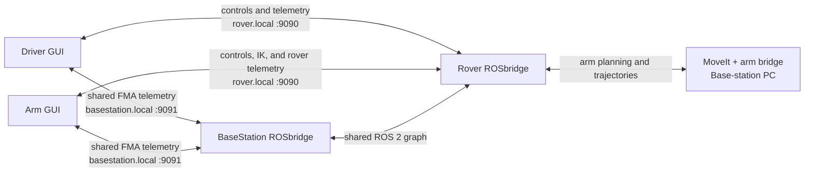
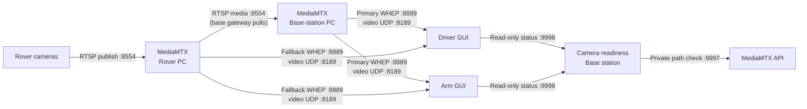

# Base station

The base station provides these services for rover operators:

- MoveIt 2 planning for Arm Position/IK mode.
- ROSbridge access to shared FMA telemetry on port `9091`.
- MediaMTX camera playback for Driver and Arm browsers.

It does not run the rover or the GUI. The rover and base-station stacks can be
started independently.

## Start

For local Windows development, enable Docker Desktop host networking in
`Settings > Resources > Network > Enable host networking` (Docker Desktop 4.34
or newer). Create the shared local camera network once:

```bash
docker network create chasmata-local-media
```

Then start this stack and the mock-rover stack in either order:

```bash
docker compose -f docker-compose.local.yml up --build
```

For the production-shaped stack, configure the static LAN addresses:

```bash
copy .env.example .env
# Edit .env with the rover and base-station static LAN IPs.
docker compose -f docker-compose.yml up --build
```

## Guides

- [Arm MoveIt planning](docs/arm-moveit.md) — packages, Position/IK flow,
  orientation modes, demos, and current safety boundary.
- [Media gateway](docs/media-gateway.md) — rover RTSP input, browser playback,
  ports, and MediaMTX configuration.
- [Networking](docs/networking.md) — local mock setup, rover LAN setup, names,
  and Command-team configuration.

## Operator and rover connections

### Controls and arm planning



### Camera video



The Driver and Arm GUIs connect directly to the rover for controls, IK, and
rover heartbeat, and independently to BaseStation ROSbridge for FMA telemetry.
Both bridges join the same ROS 2 graph; FMA remains published by Rover Control.
Camera video normally comes through base-station MediaMTX; eligible tiles can
switch directly to rover MediaMTX if the base gateway is unavailable. MoveIt
handles Arm Position/IK planning.
