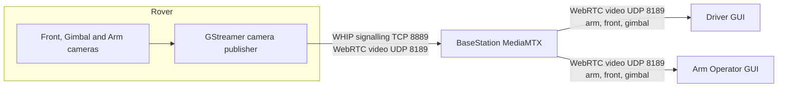

# Media gateway

BaseStation MediaMTX is the camera gateway. Rover camera publishers send the
`front`, `gimbal`, and `arm` paths directly to its WHIP endpoints, then it
serves those paths to the hosted GUI through the BaseStation `/media/` proxy
route.

The rover publishes to `http://<base-station-lan-ip>:8889/<camera>/whip`.
Production MediaMTX uses host networking and automatically advertises
BaseStation network interfaces for WebRTC ICE candidates. Browser WHEP
signalling is proxied from
`http://<base-station-lan-ip>/media/<camera>/whep`. WebRTC media uses
BaseStation UDP port `8189`.
