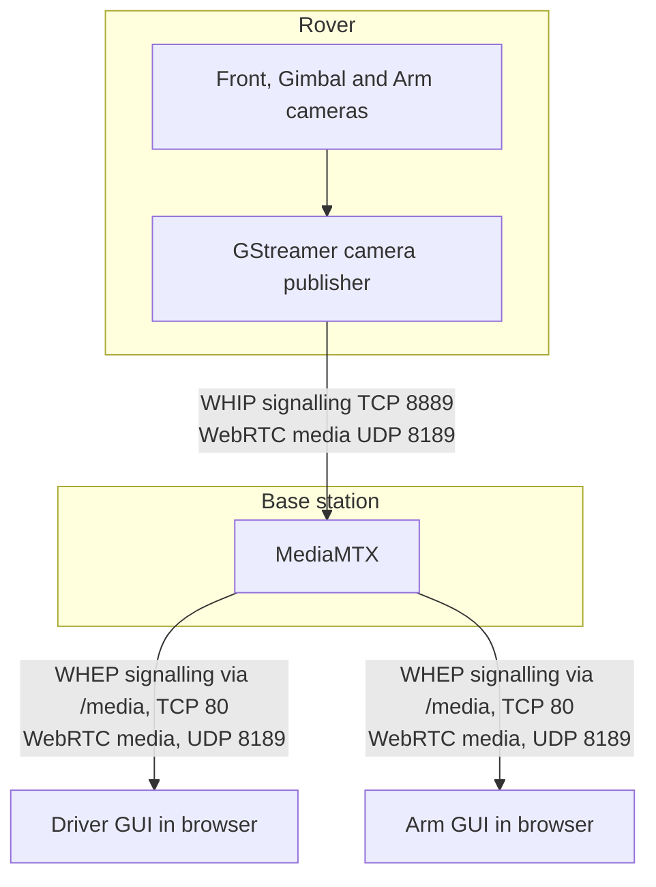

# Camera streams

The GUI displays Front, Gimbal, and Arm feeds through the BaseStation-hosted
`/media/<camera>/whep` route. Rover camera publishers send the three WHIP
streams directly to BaseStation MediaMTX, which fans out browser WebRTC
sessions.

Local Angular development continues to use the BaseStation MediaMTX address in
`src/environments/environment.ts`. Production derives the BaseStation origin
from the loaded operations website.
