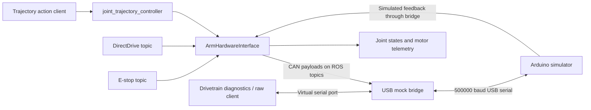

# Arm control stack: mock-hardware verification and handover

**Handover date:** 11 November 2026  
**Test date:** 10 November 2026  
**Tested branch:** `Mock-Hardware`  
**Tested commit:** `b552968e6a577fad36b22eba3c61667920092d2c`  
**Disposition:** The repository version failed end-to-end verification. A temporary USB pacing change passed the final integration run; it has not been incorporated into the production bridge.

## 1. What the next engineer needs to know

The Arduino responds correctly to isolated requests, and the ROS arm controllers load successfully. Under normal arm traffic, the original USB bridge produces unreliable command delivery: joint positions differ from requested targets, concurrent drivetrain reads fail intermittently, and one run returned nonzero speed after E-stop assertion. Correct outgoing payloads were observed on the ROS CAN topic.

Sending one arm packet per bridge timer callback, instead of up to sixteen, restored the tested command and feedback paths. This strongly implicates burst traffic and board receive pressure. Buffer overflow was not instrumented directly; treat that mechanism as a hypothesis supported by the comparison, rather than a measured hardware fact.

There is also an independent correctness problem: the trajectory controller can report success despite substantial position error because per-joint position tolerances are not configured. Finally, the arm unit-test fixture fails before providing useful coverage of several behaviors because it counts queued status requests as motion commands.

Recommended order of work:

1. Make USB command delivery reliable and define handling of stale queued motion commands.
2. Require measured position agreement before a trajectory can succeed.
3. Repair the arm unit-test fixture and add focused regression coverage.
4. Extend feedback-loss, restart, and sustained-load verification before declaring the simulator path reliable.

These findings concern the USB simulator integration. They do not establish that the production CAN transport has the same failure mechanism.

## 2. Scope and architecture



The tests exercised:

- Six-joint trajectory commands through the real arm controller and hardware interface.
- Direct position and speed commands, E-stop, explicit rearming, and feedback interruption.
- Simulated encoder, speed, temperature, voltage, and fault feedback.
- Four drivetrain addresses using raw Modbus reads/writes and the ROS diagnostics service.
- The production drivetrain configuration gate and existing driver unit tests.

The tests did **not** exercise GUI interaction, MoveIt planning, physical motors, electrical CAN/RS485 communication, real encoder calibration, or production drivetrain motion. All motion values in this document are simulator feedback.

## 3. Environment and build

| Item | Tested configuration |
| --- | --- |
| USB device | `/dev/ttyUSB0` |
| USB identifier | `usb-1a86_USB_Serial-if00-port0` |
| Physical serial link | 500000 baud, 8N1 |
| Arm loop | Default 50 Hz |
| Drivetrain virtual port | Bridge-created `/dev/pts/0` in these runs; 38400 baud, 8N1 |
| ROS | Jazzy in the provided development image |
| Domain isolation | `ROS_DOMAIN_ID=87`, `ROS_LOCALHOST_ONLY=1` |
| Test container | `chasmata-mock-verify` |
| Source mount | Repository mounted read-only at `/source` |
| Build/install workspace | `/tmp/verify_ws` inside the test container |

The provided image was:

```text
vsc-test-789dac4c4e6c8692edd430b2691240279bb597763dea39c6f1f273c8359cd97a-uid
```

The original container, `eager_volhard`, could not start because its old `/run/user/1000/wayland-0` bind mount was missing. A separate container used the same image with the Arduino attached. `ros-jazzy-can-msgs` was installed inside it; the other required dependencies were already available.

Five packages built successfully: `arm_interfaces`, `telemetry_interfaces`, `rover_drivetrain_interfaces`, `dcr_arm_driver`, and `rover_drivetrain_control`. The firmware was already flashed; these tests did not upload or modify it. The USB identifier identifies the serial adapter, not a confirmed Arduino model.

## 4. Results and evidence

### 4.1 Run history

| Run | Purpose | Result |
| --- | --- | --- |
| Initial | Exercise repository code | Command tracking and concurrent diagnostics failed. An early controller-list assertion also raced controller startup. |
| Baseline repeat | Wait for both controllers and capture transmitted commands | Both controllers active; command tracking still failed, including unreliable stop feedback. |
| Paced comparison | Limit arm transmission to one packet per callback | Motion, stop, and diagnostics checks passed; an immediate freshness observation failed. |
| Paced follow-up | Record status history, settle for two seconds, observe for ten seconds | All integration assertions passed; 500 fresh/safe status samples observed. |

The controller-startup race was corrected in the harness. It is not counted as a driver defect. The freshness failure in the first paced comparison remains relevant: the later steady-state pass does not explain or eliminate that transient.

### 4.2 Idle transport and firmware watchdog

The initial joint-1 status request returned:

```text
t0018A419000000000000\r
```

This matches the expected zero-position status with 25°C synthetic temperature. All four drivetrain IDs acknowledged raw setpoint writes and returned the stored values. After 650 ms without another motion command, all four returned zero actual speed, consistent with the firmware's 500 ms watchdog.

This checks the resulting state after the timeout; it does not measure exact watchdog latency. Acknowledgements establish simulated protocol behavior, not motor movement or real-drive calibration.

### 4.3 Arm trajectory failure

The baseline repeat sent a two-second six-joint trajectory. The action returned `SUCCEEDED`, error code `0`, and “Goal successfully reached!” despite the following measured positions:

| Joint | Requested rad | Observed rad, approximately |
| --- | ---: | ---: |
| Base | 0.10 | 0.0809 |
| Shoulder | 0.15 | 0.0763 |
| Elbow | 0.20 | 0 |
| Yaw | 0.10 | 0 |
| Pitch | 0.15 | 0 |
| Roll | 0.20 | 0 |

The outgoing `/socketcan_bridge/tx` frames contained the expected encoded targets for all six IDs. For example, the final position payloads were `c204010000` for 0.1 rad, `c287010000` for 0.15 rad, and `c209020000` for 0.2 rad, subject to encoder quantization.

With the paced bridge, all six joints reached the same targets. Maximum absolute error was **0.00029125 rad**.

### 4.4 Direct commands and E-stop

For direct position targets of 11–16 degrees, the baseline repeat returned approximately:

```text
Requested: 11.000, 12.000, 13.000, 14.000, 15.000, 16.000
Observed:  10.986, 11.997, 64.797,  0.000,  0.000,  0.000
```

Correct command payloads were again visible for all IDs. E-stop passed in the initial run, but the repeat reported joint-1 speed of **300 RPM about 400 ms after E-stop assertion**. This is unreliable simulated stop feedback, not evidence of physical motion.

With pacing, direct position, a 3 RPM speed command, E-stop stopping all joints, explicit rearming, and no automatic resumption after clearing E-stop passed.

### 4.5 Feedback interruption and recovery

The harness suspended the bridge process for approximately 700 ms using `SIGSTOP`, then resumed it with `SIGCONT`. The arm driver reported stale feedback, inhibited motion, and published zero-speed commands. The previously latched direct speed did not resume after feedback recovered.

This exercises a stalled bridge process. It does not cover USB unplug/replug, a board reboot, partially delivered frames, process replacement, or every possible command-backlog state.

The final paced follow-up observed 500 control-status samples over ten seconds after a two-second settling interval. All indicated fresh feedback and safe motor status; the largest observed per-channel feedback gap was **23.7 ms**. These are host-observed timings, not hard real-time guarantees.

### 4.6 Shared drivetrain traffic

ROS diagnostic reads intermittently failed with normal arm traffic through the original bridge. With pacing, all twelve reads succeeded: three register selectors across IDs 1–4, returning raw temperature `25`, current `0`, and voltage `2400`.

The production drivetrain hardware still refused configuration because its verified initialization sequence and velocity conversion are unimplemented. This expected gate was observed and left intact. Successful diagnostics do not make drivetrain motion available.

### 4.7 Existing unit tests

All four drivetrain tests passed:

- `drivetrain_core_logic`
- `drivetrain_modbus_mock`
- `drivetrain_hardware_configuration`
- `drivetrain_telemetry_defaults`

All six arm direct-drive tests failed at frame-count assertions. The fixture expected two frames but received six. Inspection shows `read()` queues four status requests for its two joints. Clearing the callback-populated vector before those messages are delivered does not drain the subscription; the subsequent executor spin collects those four requests and two motion commands.

`colcon` reported eleven tests and seven failures because it includes the failed CTest wrapper as well as the six individual gtest failures. These are six failing arm test cases, not seven distinct functional defects. Fixing the fixture may expose further behavioral failures; those assertions have not yet been validated successfully.

## 5. Improvement plan for the arm stack

### P0: Reliable simulator transport and bounded command age

**Primary file:** [USB bridge](../../../../microcontroller/mock_hardware/usb_mock_bridge.py).

The bridge currently sends up to sixteen arm packets on a 1 ms timer callback. The diagnostic copy changes that limit to one. At 50 Hz, the current driver requests two status frames and emits one motion command for each of six joints: approximately 900 outgoing arm packets per second. A nominal 1,000-packet-per-second dispatch capacity leaves little margin for scheduling delays and recovery bursts.

Recommended implementation:

- Make pacing explicit and measurable; avoid assuming every timer callback executes exactly on time.
- Consider request/response flow control or a byte-budget scheduler accounting for firmware processing and receive-buffer capacity.
- Track queue length, oldest command age, dispatch delay, dropped commands, malformed replies, and Modbus timeouts.
- Define how newer per-joint commands replace superseded queued motion commands. Do not blindly coalesce home, fault-clear, or other commands with distinct semantics.
- Ensure stop handling invalidates pending obsolete motion commands; a stop must not sit behind an unbounded backlog.
- If adding sequence numbers, checksums, or acknowledgements to the USB envelope, version both firmware and bridge together. The current ASCII envelope lacks an integrity check.

**Acceptance:** Reproduce all six joint targets with simultaneous drivetrain diagnostics; reject corrupt frames; show bounded command age and stop latency under delayed callbacks, backlog, disconnect, and restart. Set explicit latency targets before testing. The single-packet workaround alone is not sufficient evidence for arbitrary boards or long runs.

### P0: Trajectory success must require measured convergence

**Primary file:** [arm controller configuration](../rover_ws/src/dcr_arm_driver/config/arm_controllers.yaml).

The configuration supplies a stopped-velocity tolerance but no per-joint path or goal position tolerances. The installed controller documents zero as the default for those tolerances, meaning no enforcement. The test action client did not provide its own position tolerances.

Recommended implementation:

- Configure per-joint `constraints.<joint>.trajectory` and `constraints.<joint>.goal`, plus a deliberate goal-time allowance.
- Choose limits from encoder resolution, mechanical accuracy, expected tracking lag, and measured communication delay. The observed mock error is not a production calibration standard.
- Test default configuration and client-supplied tolerances separately.
- Check that an inhibited or unresponsive arm cannot complete a nontrivial trajectory successfully just because its duration elapsed.

**Acceptance:** A reachable goal succeeds within its configured tolerance; a frozen joint, missing command, or excessive tracking error aborts with an appropriate action error. Preserve the terminal action result and measured positions in the test evidence.

### P1: Repair deterministic driver tests

**Primary file:** [direct-drive tests](../rover_ws/src/dcr_arm_driver/test/test_direct_drive.cpp).

Separate status-request observations from motion-command observations by CAN command byte and joint ID. Drain the executor at explicit phase boundaries, or wait for the expected semantic event with a bounded deadline. Avoid fixing the assertion by merely changing `2` to `6`: that would retain the scheduling dependency and obscure what is actually being asserted.

After repairing the fixture, rerun existing tests for command persistence, invalid inputs, joint limits, stale feedback, and E-stop. Add regression checks for transport backlog and false trajectory success at the appropriate integration layer.

**Acceptance:** All existing six arm cases pass for their intended behaviors across repeated runs; a deliberate behavioral regression causes the relevant assertion to fail.

### P1: Make freshness and recovery observable

**Primary file:** [hardware interface](../rover_ws/src/dcr_arm_driver/src/arm_hardware_interface.cpp).

Retain the existing startup inhibition, explicit E-stop state, 250 ms feedback checks, and explicit rearming behavior. Expand diagnostics to identify the affected joint and missing status type, and distinguish transport loss from out-of-range or ambiguous encoder feedback. Publish feedback ages and transition reasons where useful to operators and tests.

Investigate the initial paced run's freshness failure instead of treating a steady-state pass after settling as a complete resolution. If protocol sequencing is added, use it to distinguish recent board measurements from old replies that have just arrived at the host.

**Acceptance:** Deterministic tests cover loss of only one joint or status type, reported faults, encoder ambiguity, USB reset, controller restart, and active-goal recovery. Old speed commands and old trajectory goals must not silently rearm motion.

### P2: Sustainable polling and reusable integration tests

Measure the cost and required freshness of each status type before reducing polling rates. Any slower diagnostic schedule must remain compatible with the driver's freshness gate; changing polling without revisiting that contract can inhibit motion unexpectedly.

Promote the preserved harness into a maintained test entry point with configurable device, domain, output directory, and build paths. Make it return nonzero on failed assertions, record the tested firmware identity when available, and preserve results independently of `/tmp`. Add sustained-load and fault-recovery runs with agreed durations and limits. Keep simulator assertions separate from physical-hardware validation.

## 6. Reproduction procedure

The following reconstructs the environment using the locally provided image. Run host commands from the repository root. Use a fresh container name if `chasmata-mock-verify` already exists; the existing stopped container retains the original build.

```bash
docker run -d --name chasmata-mock-verify \
  --user root --device=/dev/ttyUSB0:/dev/ttyUSB0 \
  -v "$PWD:/source:ro" \
  -e ROS_DOMAIN_ID=87 -e ROS_LOCALHOST_ONLY=1 \
  --entrypoint /bin/bash \
  vsc-test-789dac4c4e6c8692edd430b2691240279bb597763dea39c6f1f273c8359cd97a-uid \
  -lc 'exec sleep infinity'

docker exec chasmata-mock-verify bash -lc \
  'apt-get update -qq && apt-get install -y ros-jazzy-can-msgs'

docker exec chasmata-mock-verify bash -lc '
  source /opt/ros/jazzy/setup.bash
  mkdir -p /tmp/verify_ws
  cd /tmp/verify_ws
  colcon build --base-paths /source/rover/control/arm/rover_ws/src \
    /source/rover/control/drivetrain /source/interfaces \
    --packages-up-to dcr_arm_driver rover_drivetrain_control --parallel-workers 2
'
```

Copy the preserved harness into the container:

```bash
docker cp rover/control/arm/docs/evidence/mock-hardware-2026-11-10/verify.py \
  chasmata-mock-verify:/tmp/verify.py
docker cp rover/control/arm/docs/evidence/mock-hardware-2026-11-10/paced_bridge.py \
  chasmata-mock-verify:/tmp/paced_bridge.py
```

Run each variant sequentially so that only one bridge owns the physical USB port. Close Arduino Serial Monitor first. The harness starts and stops its own ROS processes and asserts E-stop during cleanup.

```bash
# Repository bridge.
docker exec chasmata-mock-verify bash -lc '
  source /tmp/verify_ws/install/setup.bash
  VERIFY_OUT=/tmp/baseline python3 -u /tmp/verify.py
'

# Diagnostic pacing copy.
docker exec chasmata-mock-verify bash -lc '
  source /tmp/verify_ws/install/setup.bash
  VERIFY_OUT=/tmp/paced-followup VERIFY_BRIDGE=/tmp/paced_bridge.py \
    python3 -u /tmp/verify.py
'
```

**Harness limitation:** This preserved investigative script exits zero even when assertions recorded in `results.json` fail. Inspect every `passed` field. Some entries capture evidence rather than assert behavior; the total count is not a coverage metric. Do not use its process exit code as a CI gate without fixing that behavior.

Run the existing unit tests separately:

```bash
docker exec chasmata-mock-verify bash -lc '
  source /tmp/verify_ws/install/setup.bash
  cd /tmp/verify_ws
  colcon test --base-paths /source/rover/control/arm/rover_ws/src \
    /source/rover/control/drivetrain /source/interfaces \
    --packages-select dcr_arm_driver rover_drivetrain_control
  colcon test-result --verbose
'
```

Export fresh results before removing the container. The bridge's PTY name can change on every launch and exists inside the container. The harness reads that name from the bridge log.

## 7. Evidence and handover state

Selected evidence is preserved alongside this document so the findings do not depend on the original temporary directory:

| Artifact | Purpose |
| --- | --- |
| [Initial results](evidence/mock-hardware-2026-11-10/initial-results.json) | First run, including startup race |
| [Baseline results](evidence/mock-hardware-2026-11-10/baseline-results.json) | Corrected startup waiting and command captures |
| [Paced results](evidence/mock-hardware-2026-11-10/paced-results.json) | First comparison, including freshness failure |
| [Paced follow-up](evidence/mock-hardware-2026-11-10/paced-followup-results.json) | Successful final integration assertions |
| [Unit-test log](evidence/mock-hardware-2026-11-10/unit-tests.log) | Existing driver-test failures and summaries |
| [Harness](evidence/mock-hardware-2026-11-10/verify.py) | Final investigative test implementation |
| [Paced bridge copy](evidence/mock-hardware-2026-11-10/paced_bridge.py) | Diagnostic variant, not the production bridge |

The complete original logs, status history, build events, and installed tolerance implementation were exported to `/tmp/chasmata-mock-verification` on the test host. That location is temporary and may disappear. The preserved harness is the final revision, including the two-second settling interval; earlier results used the earlier observation sequence described above.

At completion, E-stop was asserted, test processes were stopped, and `chasmata-mock-verify` was stopped. The tested repository code and Arduino firmware were not modified during verification. The next owner should implement and review the proposed fixes, rerun the baseline using the actual changed repository files, and archive new evidence against the new commit before changing the disposition of this report.
