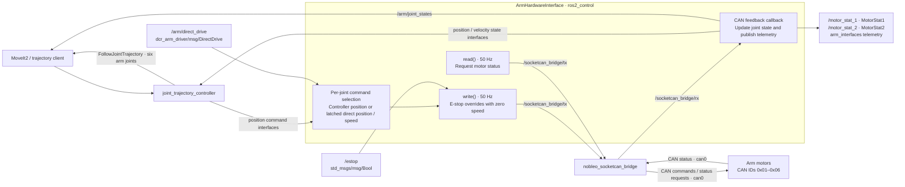

# dcr_arm_driver

ROS 2 (Jazzy) **ros2_control** hardware interface for controlling the DCR
6-DOF robotic arm via CAN bus communication using
[`nobleo_socketcan_bridge`](../nobleo_socketcan_bridge).

The end effector is **not** handled here — see
[`dcr_ee_driver`](../dcr_ee_driver).

---

## Overview



* Provides a **ros2_control `SystemInterface`** plugin
  (`dcr_arm_driver/ArmHardwareInterface`).
* **Publishes** `can_msgs/msg::Frame` on `/socketcan_bridge/tx` and
  **subscribes** to `/socketcan_bridge/rx` (the `nobleo_socketcan_bridge`
  topics).
* Exposes telemetry from `arm_interfaces` on dedicated topics
  (`/motor_stat_1`, `/motor_stat_2`). Direct drive uses the separate
  `/arm/direct_drive` topic with `dcr_arm_driver/msg/DirectDrive`.
* Exposes all six MoveIt arm joints to `arm_controller` and publishes feedback
  on `/arm/joint_states`, matching the existing base-station MoveIt package.
* Runs a **50 Hz** control loop (configured in `arm_controllers.yaml`).

---

## Robot specification

### Arm kinematics

* **6 DOF revolute joints**: base, shoulder, elbow, yaw, pitch, roll
* **End-effector link**: fixed attachment point (gripper / sensor)
* **Base link**: fixed to the rover platform

### Joint configuration

| Joint Name     | CAN ID | Range (rad)        | Velocity |
|----------------|--------|--------------------|----------|
| base_joint     | 0x01   | -3.2288 to 3.2288  | 1.0 rad/s |
| shoulder_joint | 0x02   | -0.0873 to 3.2288  | 1.0 rad/s |
| elbow_joint    | 0x03   | -0.0873 to 4.7997  | 1.0 rad/s |
| yaw_joint      | 0x04   | -1.6581 to 3.2288  | 1.0 rad/s |
| pitch_joint    | 0x05   | -0.0873 to 4.7997  | 1.0 rad/s |
| roll_joint     | 0x06   | -3.2288 to 3.2288  | 1.0 rad/s |

The URDF assigns arm CAN IDs `0x01`–`0x06`; the end-effector controller remains
separate on CAN ID `0x07`. Change the corresponding `<joint>_can_id` parameters
in the URDF if the rover's motor IDs differ.

---

## CAN protocol

All arm commands use **CAN ID = joint CAN ID**, with the command byte in
`data[0]`.

**Motor commands**

| Command byte | Meaning           | Payload                                                |
|--------------|-------------------|--------------------------------------------------------|
| `0xC1`       | Speed control     | 4-byte little-endian signed, scaled by 100             |
| `0xC2`       | Position control  | 4-byte little-endian signed, `angle_deg × 16384 / 360` |
| `0xB1`       | Set home position | none                                                   |
| `0xAF`       | Clear faults      | none (sent to ID `0x00`)                               |

**Motor status**

| Command byte | Meaning  | Payload                                |
|--------------|----------|----------------------------------------|
| `0xA4`       | Status 1 | temperature, current, speed, angle     |
| `0xAE`       | Status 2 | bus voltage, bus current, mode, faults |

---

## Exposed interfaces

### ros2_control

| Type    | Interface                        |
|---------|----------------------------------|
| Command | `position`                       |
| State   | `position` (rad), `velocity` (rad/s) |

### Topics

| Topic                  | Message          | Direction | Description                            |
|------------------------|------------------|-----------|----------------------------------------|
| `/motor_stat_1`        | `MotorStat1`     | publish   | temperature, current, speed, angle     |
| `/motor_stat_2`        | `MotorStat2`     | publish   | bus voltage, bus current, mode, faults |
| `/arm/direct_drive`   | `dcr_arm_driver/DirectDrive` | subscribe | persistent per-joint direct command |
| `/arm/joint_states`   | `sensor_msgs/JointState` | publish | six-joint feedback consumed by MoveIt |
| `/arm_controller/follow_joint_trajectory` | `control_msgs/FollowJointTrajectory` action | provide | six-joint trajectory execution for MoveIt |
| `/estop`              | `std_msgs/Bool`  | subscribe | stop all joints while asserted         |
| `/socketcan_bridge/tx` | `can_msgs/Frame` | publish   | outgoing CAN frames                    |
| `/socketcan_bridge/rx` | `can_msgs/Frame` | subscribe | incoming CAN frames                    |

---

## Message definitions

Defined in `arm_interfaces`:

```text
# MotorStat1.msg
int64   id
int64   temp
float64 current
float64 speed
float64 angle

# MotorStat2.msg
int64   id
float64 busv
float64 busc
string  mode
string  fault

```

---

Direct-drive commands are defined in `dcr_arm_driver`, separately from telemetry:

```text
# DirectDrive.msg
uint8 CONTROLLER=0
uint8 POSITION=1
uint8 SPEED=2
uint32 id       # joint CAN ID
uint8 mode
float64 value  # degrees for POSITION; motor speed units for SPEED
```

`/motor_move` is no longer subscribed to. The legacy `MotorMove` definition
remains in `arm_interfaces` for compatibility, but this driver uses that package
only for telemetry.

## Build

The interface package `arm_interfaces` must be built **first**:

```bash
cd <your_ws>              # e.g. rover/control/arm/rover_ws
colcon build --packages-select arm_interfaces dcr_arm_driver
source install/setup.bash
```

### Dependencies

* ROS 2 Jazzy: `rclcpp`, `rclcpp_lifecycle`, `hardware_interface`, `pluginlib`,
  `controller_manager`, `joint_state_broadcaster`, `joint_trajectory_controller`
* `can_msgs`, `arm_interfaces`, `std_msgs`, `rosidl_default_generators`,
  `rosidl_default_runtime`
* `nobleo_socketcan_bridge` (runtime — provides the CAN <-> ROS bridge)

Install via `rosdep` if missing:

```bash
rosdep install --from-paths src --ignore-src -y
```

---

## Run

```bash
ros2 launch dcr_arm_driver arm_control.launch.py
```

This starts:

* `controller_manager` (`ros2_control_node`) with the URDF + `config/arm_controllers.yaml`
* `joint_state_broadcaster` spawner
* `arm_controller` (`joint_trajectory_controller`) spawner

You must also have the CAN bridge running and the CAN interface up:

```bash
# Bring up the CAN interface (500 kbps)
sudo ip link set can0 type can bitrate 500000
sudo ip link set can0 up
ip link show can0        # verify

# Monitor CAN traffic (optional)
candump can0

# Run the socketcan bridge (separate package)
ros2 run nobleo_socketcan_bridge socketcan_bridge --ros-args -p interface:=can0
```

The existing base-station MoveIt package uses the same six joint names and
action endpoint. Start it using `basestation/docs/arm-moveit.md`; its state
remapping expects `/arm/joint_states`, which this launch publishes.

---

## Parameters

Set in the URDF `<ros2_control>` block (`urdf/robot_arm.urdf`) and
`config/arm_controllers.yaml`.

| Parameter        | Type   | Default              | Description            |
|------------------|--------|----------------------|------------------------|
| `can_interface`  | string | `can0`               | SocketCAN device name  |
| `<joint>_can_id` | int    | `0x01`–`0x06` | CAN ID per arm joint   |
| `update_rate`    | int    | `50`                 | Control loop freq (Hz) |

Controller (`config/arm_controllers.yaml`):

| Controller                | Type                          | Interfaces                                     |
|---------------------------|-------------------------------|------------------------------------------------|
| `joint_state_broadcaster` | `joint_state_broadcaster`     | six joints: `position`, `velocity`; publishes `/arm/joint_states` |
| `arm_controller`          | `joint_trajectory_controller` | six joints; cmd: `position`; state: `position`, `velocity` |

---

## Usage examples

Inspect telemetry published by the driver:

```bash
ros2 topic echo /motor_stat_1
ros2 topic echo /motor_stat_2
```

Direct drive bypasses MoveIt2 for the selected joint. Each accepted command is
latched and sent by the 50 Hz `write()` loop until replaced, released with
`CONTROLLER`, or reset on hardware activation. Other joints remain under
controller control. Speed commands persist even if the publishing node exits;
send zero speed to stop that joint.

```bash
# Position control (POSITION=1), value in degrees
ros2 topic pub --once /arm/direct_drive dcr_arm_driver/msg/DirectDrive "{id: 1, mode: 1, value: 10.0}"

# Speed control (SPEED=2), CAN speed payload = value * 100
ros2 topic pub --once /arm/direct_drive dcr_arm_driver/msg/DirectDrive "{id: 1, mode: 2, value: 20.0}"

# Stop this joint while retaining direct control
ros2 topic pub --once /arm/direct_drive dcr_arm_driver/msg/DirectDrive "{id: 1, mode: 2, value: 0.0}"

# Return this joint to its current ros2_control position target (CONTROLLER=0)
ros2 topic pub --once /arm/direct_drive dcr_arm_driver/msg/DirectDrive "{id: 1, mode: 0}"
```

The controller can continue updating its target during direct drive. Returning
to `CONTROLLER` immediately uses that target; set the intended controller target
before handing control back. Unknown IDs, invalid modes, and non-finite or
unencodable values are ignored. Commands received while inactive or while
E-stop is asserted are ignored.

`/estop` overrides both command sources with repeated zero-speed CAN frames.
Clearing E-stop resumes the previously selected command, including a latched
direct speed. Hardware reactivation resets every joint to controller mode.

Watch the raw CAN frames:

```bash
candump can0
```

---

## Relationship to `dcr_ee_driver`

* `dcr_arm_driver` controls the six arm joints through **ros2_control**.
* `dcr_ee_driver` controls **only the end effector** through its **own topic**,
  bypassing ros2_control entirely (should be scrapped or changed later).

---

## Package layout

```
dcr_arm_driver/
├── CMakeLists.txt
├── package.xml
├── plugins.xml
├── README.md
├── config/
│   ├── arm_controllers.yaml
│   └── arm_control.launch.py
├── include/dcr_arm_driver/
│   ├── motor.hpp
│   └── arm_hardware_interface.hpp
├── msg/
│   └── DirectDrive.msg
├── src/
│   ├── motor.cpp
│   └── arm_hardware_interface.cpp
└── urdf/
    └── robot_arm.urdf
```
