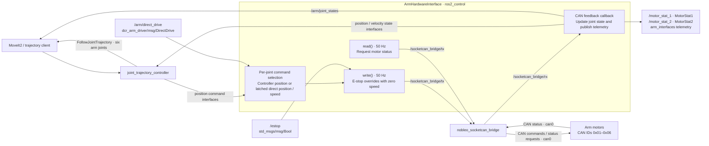

# dcr_arm_driver

ROS 2 (Jazzy) **ros2_control** hardware interface for controlling the DCR
6-DOF robotic arm via CAN bus communication using
[`nobleo_socketcan_bridge`](../nobleo_socketcan_bridge).

The end effector is **not** handled here — see
[`dcr_ee_driver`](../dcr_ee_driver).

---

## Overview



* Provides a **ros2_control `SystemInterface`** plugin
  (`dcr_arm_driver/ArmHardwareInterface`).
* **Publishes** `can_msgs/msg::Frame` on `/socketcan_bridge/tx` and
  **subscribes** to `/socketcan_bridge/rx` (the `nobleo_socketcan_bridge`
  topics).
* Exposes telemetry from `arm_interfaces` on dedicated topics
  (`/motor_stat_1`, `/motor_stat_2`). Direct drive uses the separate
  `/arm/direct_drive` topic with `dcr_arm_driver/msg/DirectDrive`.
* Exposes all six MoveIt arm joints to `arm_controller` and publishes feedback
  on `/arm/joint_states`, matching the existing base-station MoveIt package.
* Runs a **50 Hz** control loop (configured in `arm_controllers.yaml`).

---

## Robot specification

### Arm kinematics

* **6 DOF revolute joints**: base, shoulder, elbow, yaw, pitch, roll
* **End-effector link**: fixed attachment point (gripper / sensor)
* **Base link**: fixed to the rover platform

### Joint configuration

| Joint Name     | CAN ID | Range (rad)        | Velocity |
|----------------|--------|--------------------|----------|
| base_joint     | 0x01   | -3.2288 to 3.2288  | 1.0 rad/s |
| shoulder_joint | 0x02   | -0.0873 to 3.2288  | 1.0 rad/s |
| elbow_joint    | 0x03   | -0.0873 to 4.7997  | 1.0 rad/s |
| yaw_joint      | 0x04   | -1.6581 to 3.2288  | 1.0 rad/s |
| pitch_joint    | 0x05   | -0.0873 to 4.7997  | 1.0 rad/s |
| roll_joint     | 0x06   | -3.2288 to 3.2288  | 1.0 rad/s |

The URDF assigns arm CAN IDs `0x01`–`0x06`; the end-effector controller remains
separate on CAN ID `0x07`. Change the corresponding `<joint>_can_id` parameters
in the URDF if the rover's motor IDs differ.

---

## CAN protocol

All arm commands use **CAN ID = joint CAN ID**, with the command byte in
`data[0]`.

**Motor commands**

| Command byte | Meaning           | Payload                                                |
|--------------|-------------------|--------------------------------------------------------|
| `0xC1`       | Speed control     | 4-byte little-endian signed, scaled by 100             |
| `0xC2`       | Position control  | 4-byte little-endian signed, `angle_deg × 16384 / 360` |
| `0xB1`       | Set home position | none                                                   |
| `0xAF`       | Clear faults      | none (sent to ID `0x00`)                               |

**Motor status**

| Command byte | Meaning  | Payload                                |
|--------------|----------|----------------------------------------|
| `0xA4`       | Status 1 | temperature, current, speed, angle     |
| `0xAE`       | Status 2 | bus voltage, bus current, mode, faults |

---

## Exposed interfaces

### ros2_control

| Type    | Interface                        |
|---------|----------------------------------|
| Command | `position`                       |
| State   | `position` (rad), `velocity` (rad/s) |

The motor telemetry message retains angle in degrees and speed in RPM. The
ros2_control state interface unwraps each encoder angle into that joint's
configured position limits and converts RPM to radians per second.

### Topics

| Topic                  | Message          | Direction | Description                            |
|------------------------|------------------|-----------|----------------------------------------|
| `/motor_stat_1`        | `MotorStat1`     | publish   | temperature, current, speed (RPM), angle (degrees) |
| `/motor_stat_2`        | `MotorStat2`     | publish   | bus voltage, bus current, mode, faults |
| `/arm/direct_drive`   | `dcr_arm_driver/DirectDrive` | subscribe | persistent per-joint direct command |
| `/arm/joint_states`   | `sensor_msgs/JointState` | publish | six-joint feedback consumed by MoveIt |
| `/arm_controller/follow_joint_trajectory` | `control_msgs/FollowJointTrajectory` action | provide | six-joint trajectory execution for MoveIt |
| `/estop`              | `std_msgs/Bool`  | subscribe | stop all joints while asserted         |
| `/socketcan_bridge/tx` | `can_msgs/Frame` | publish   | outgoing CAN frames                    |
| `/socketcan_bridge/rx` | `can_msgs/Frame` | subscribe | incoming CAN frames                    |

### Service

| Service         | Type                 | Description                                      |
|-----------------|----------------------|--------------------------------------------------|
| `/arm/set_home` | `std_srvs/srv/Trigger` | Set motor home only with fresh feedback, fault-free motor status, all joints at zero, and no active trajectory |

The `/estop` subscription remains active while the hardware is inactive. On
activation, the driver sends zero speed to every motor and starts
motion-inhibited. It requires an explicit `/estop` state message; the E-stop
publisher must publish its current state, including `false` when clear, after
startup. Until that message arrives, the driver sends zero speed and ignores
direct-drive commands. It also waits for fresh encoder and motor status from
every joint before accepting motion, and seeds each position target from fresh
encoder feedback. Activation does not automatically clear reported motor
faults. Base and roll encoder readings in the overlapping turn range are
ambiguous on startup; the driver keeps motion inhibited until each such joint
reports an angle that identifies a unique turn. If either joint is in that
range at startup, move it into an unambiguous position and let feedback update
before requesting motion.

Homing is explicit; activation does not redefine the motor coordinate frame.
The driver rejects homing while an accepted, executing, or canceling trajectory
goal exists, while direct drive is selected, or unless every joint is stationary
within 0.05 rad/s at its existing zero position (within 0.02 rad). Move the arm
to zero, return to controller mode, and cancel all trajectory goals before calling:

```bash
ros2 service call /arm/set_home std_srvs/srv/Trigger {}
```

This sends zero-speed and motor home commands. The next hardware read resets
reported positions and controller targets to zero. This restriction prevents
rebasing the coordinate frame under a held controller target.

---

## Message definitions

Defined in `arm_interfaces`:

```text
# MotorStat1.msg
int64   id
int64   temp
float64 current
float64 speed
float64 angle

# MotorStat2.msg
int64   id
float64 busv
float64 busc
string  mode
string  fault

```

---

Direct-drive commands are defined in `dcr_arm_driver`, separately from telemetry:

```text
# DirectDrive.msg
uint8 CONTROLLER=0
uint8 POSITION=1
uint8 SPEED=2
uint32 id       # joint CAN ID
uint8 mode
float64 value  # degrees for POSITION; RPM for SPEED
```

`/motor_move` is no longer subscribed to. The legacy `MotorMove` definition
remains in `arm_interfaces` for compatibility, but this driver uses that package
only for telemetry.

## Build

The interface package `arm_interfaces` must be built **first**:

```bash
cd <your_ws>              # e.g. rover/control/arm/rover_ws
colcon build --packages-select arm_interfaces dcr_arm_driver
source install/setup.bash
```

### Dependencies

* ROS 2 Jazzy: `rclcpp`, `rclcpp_lifecycle`, `hardware_interface`, `pluginlib`,
  `controller_manager`, `joint_state_broadcaster`, `joint_trajectory_controller`
* `can_msgs`, `arm_interfaces`, `std_msgs`, `std_srvs`, `urdf`,
  `rosidl_default_generators`, `rosidl_default_runtime`
* `nobleo_socketcan_bridge` (runtime — provides the CAN <-> ROS bridge)

Install via `rosdep` if missing:

```bash
rosdep install --from-paths src --ignore-src -y
```

---

## Run

```bash
ros2 launch dcr_arm_driver arm_control.launch.py
```

This starts:

* `controller_manager` (`ros2_control_node`) with the URDF + `config/arm_controllers.yaml`
* `joint_state_broadcaster` spawner
* `arm_controller` (`joint_trajectory_controller`) spawner

You must also have the CAN bridge running and the CAN interface up:

```bash
# Bring up the CAN interface (500 kbps)
sudo ip link set can0 type can bitrate 500000
sudo ip link set can0 up
ip link show can0        # verify

# Monitor CAN traffic (optional)
candump can0

# Run the socketcan bridge (separate package)
ros2 run nobleo_socketcan_bridge socketcan_bridge --ros-args -p interface:=can0
```

The existing base-station MoveIt package uses the same six joint names and
action endpoint. Start it using `basestation/docs/arm-moveit.md`; its state
remapping expects `/arm/joint_states`, which this launch publishes.

---

## Parameters

Set in the URDF `<ros2_control>` block (`urdf/robot_arm.urdf`) and
`config/arm_controllers.yaml`.

| Parameter        | Type   | Default              | Description            |
|------------------|--------|----------------------|------------------------|
| `can_interface`  | string | `can0`               | SocketCAN device name  |
| `<joint>_can_id` | int    | `0x01`–`0x06` | CAN ID per arm joint   |
| URDF joint `velocity` | float | set per joint | Direct-speed limit in rad/s, read from each joint's URDF `<limit>` |
| `update_rate`    | int    | `50`                 | Control loop freq (Hz) |

Controller (`config/arm_controllers.yaml`):

| Controller                | Type                          | Interfaces                                     |
|---------------------------|-------------------------------|------------------------------------------------|
| `joint_state_broadcaster` | `joint_state_broadcaster`     | six joints: `position`, `velocity`; publishes `/arm/joint_states` |
| `arm_controller`          | `joint_trajectory_controller` | six joints; cmd: `position`; state: `position`, `velocity` |

---

## Usage examples

Inspect telemetry published by the driver:

```bash
ros2 topic echo /motor_stat_1
ros2 topic echo /motor_stat_2
```

Direct drive bypasses MoveIt2 for the selected joint. Each accepted command is
latched and sent by the 50 Hz `write()` loop until replaced, released with
`CONTROLLER`, or reset on hardware activation. Other joints remain under
controller control. Speed commands persist even if the publishing node exits;
send zero speed to stop that joint. Hardware reactivation seeds controller
targets from fresh feedback before sending position commands.

```bash
# Position control (POSITION=1), value in degrees
ros2 topic pub --once /arm/direct_drive dcr_arm_driver/msg/DirectDrive "{id: 1, mode: 1, value: 10.0}"

# Speed control (SPEED=2), value in RPM; limited by the joint's URDF max velocity
ros2 topic pub --once /arm/direct_drive dcr_arm_driver/msg/DirectDrive "{id: 1, mode: 2, value: 5.0}"

# Stop this joint while retaining direct control
ros2 topic pub --once /arm/direct_drive dcr_arm_driver/msg/DirectDrive "{id: 1, mode: 2, value: 0.0}"

# Return this joint to its current ros2_control position target (CONTROLLER=0)
ros2 topic pub --once /arm/direct_drive dcr_arm_driver/msg/DirectDrive "{id: 1, mode: 0}"
```

The controller can continue updating its target during direct drive. Returning
to `CONTROLLER` immediately uses that target; set the intended controller target
before handing control back. Unknown IDs, invalid modes, and non-finite or
unencodable values are ignored. Commands received while inactive, while E-stop
is asserted or its state has not yet been received, or while any motor status is
missing, stale, or reports a fault are ignored.

Encoder or motor status older than 250 ms causes the driver to send zero speed,
clear latched direct commands, and inhibit all controller motion. An encoder
sample outside its URDF position limits is treated as invalid immediately and
also inhibits motion. When motor status becomes unsafe, the driver snapshots
each joint's latest measured position for its hold target. A reported motor
fault stops that joint and inhibits the arm. After feedback and motor status
recover, the trajectory action must report idle before a new trajectory can
re-enable controller motion. Direct speed
commands are limited to each joint's URDF `velocity` limit (converted to RPM)
and are suppressed when they would move outward within 0.02 rad of a configured
joint limit; inward commands remain available so the joint can move away from a
limit.

`/estop` overrides both command sources with repeated zero-speed CAN frames.
Asserting E-stop clears latched direct modes and inhibits controller motion.
When E-stop clears, the arm holds its measured pose; it does not resume an old
trajectory or speed command. Cancel any prior trajectory goal if it remains
active, wait until the action status is idle, then send a new trajectory goal
to re-enable controller motion. A new explicit direct position or speed command
can operate a joint while controller motion is inhibited if all encoder and
motor status is fresh and fault-free. Hardware deactivation, cleanup, shutdown,
and error transitions send zero-speed frames to every joint before destroying
the CAN publisher. Hardware reactivation returns all joints to the
motion-inhibited controller state.

Watch the raw CAN frames:

```bash
candump can0
```

---

## Relationship to `dcr_ee_driver`

* `dcr_arm_driver` controls the six arm joints through **ros2_control**.
* `dcr_ee_driver` controls **only the end effector** through its **own topic**,
  bypassing ros2_control entirely (should be scrapped or changed later).

---

## Package layout

```
dcr_arm_driver/
├── CMakeLists.txt
├── package.xml
├── plugins.xml
├── README.md
├── config/
│   ├── arm_controllers.yaml
│   └── arm_control.launch.py
├── include/dcr_arm_driver/
│   ├── motor.hpp
│   └── arm_hardware_interface.hpp
├── msg/
│   └── DirectDrive.msg
├── src/
│   ├── motor.cpp
│   └── arm_hardware_interface.cpp
└── urdf/
    └── robot_arm.urdf
```
