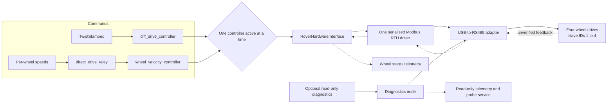

# Rover drivetrain control

ROS 2 Jazzy development package for four BLD-305S wheel drives. All drives share one USB-to-RS485 adapter and Modbus RTU connection; slave IDs 1–4 must be unique. This package is **not validated for motion**: the hardware lifecycle gate remains closed until controller initialization, feedback, stop behavior, and timing are verified.

## How it works



Normal drive commands pass through `ros2_control`; the diagnostics node only reads registers. A Modbus acknowledgement confirms a reply, not that a motor moved. Wheel-side mirroring is configured separately from the shared bus.

## Build and test

From the repository root in a ROS 2 Jazzy environment:

```bash
sudo apt install libmodbus-dev pkg-config
source /opt/ros/jazzy/setup.bash
colcon build --packages-up-to rover_drivetrain_control --symlink-install
source install/setup.bash
colcon test --packages-select rover_drivetrain_control
colcon test-result --verbose
ros2 run rover_drivetrain_control check_drivetrain_plugin
```

## Read-only diagnostics

The launch defaults to probing disabled and does not open a serial port:

```bash
ros2 launch rover_drivetrain_control diagnostics.launch.py
ros2 topic echo /drivetrain_diagnostics/telemetry
```

For an explicitly enabled workshop probe, provide the confirmed adapter settings. Example framing and baud below are placeholders; all four drives must share them. Only one process may own the adapter at a time.

```bash
ros2 launch rover_drivetrain_control diagnostics.launch.py \
  enable_readonly_probe:=true serial_device:=/dev/ttyUSB0 \
  baud_rate:=9600 parity:=N data_bits:=8 stop_bits:=1 response_timeout_ms:=30
```

Every drive ships as address 1. Until the IDs are set to 1–4, connect and probe one drive at a time, because several drives at the same address will answer together and corrupt the reply.

Last year’s rover used shared addresses (1 = right side, 2 = left side), so drives may be saved at address 1 or 2. Probe both, with one drive connected at a time.

Probe a drive by slave ID; `bus` must be `drivetrain`:

```bash
ros2 service call /drivetrain_diagnostics/read_motor_diagnostic \
  rover_drivetrain_interfaces/srv/ReadMotorDiagnostic \
  "{bus: drivetrain, address: 1, register_selector: 1}"
```

Every selector is a function code 03 read. The service returns the raw register value, never converted to physical units. Any other selector is rejected before anything is sent on the bus.

| Selector | Register | Meaning | Status |
|---|---|---|---|
| 1 | `0x0096` | Driver internal temperature | Manual-cited, bench check pending |
| 2 | `0x00B6` | Actual motor current | Manual-cited, bench check pending |
| 3 | `0x00C6` | Actual motor voltage | Manual-cited, bench check pending |
| 4 | `0x00A6` | Drive address | Manual-cited, bench check pending |
| 5 | `0x00F6` | Baud code (`01` = 9600, `04` = 38400) | Manual-cited, bench check pending |
| 6 | `0x0076` | Fault code | Manual-cited, bench check pending |
| 7 | `0x0066` | Running status (`0` stop, `1` forward, `2` reverse, `3` brake) | Manual-cited, bench check pending |
| 8 | `0x005F` | Actual speed (raw) | Manual-cited, bench check pending |
| 9 | `0x0116` | Motor pole pairs (manual default 5) | Manual-cited, bench check pending |
| 10 | `0x0136` | Control mode (`1` = internal, `0` = external) | Manual-cited, bench check pending; the manual lists this register for writes only |

The response `detail` can name the manual meaning of a value, such as a fault name, but `raw_value` is always the raw register. Selectors 6 and 8 also fill `raw_fault` and `measured_raw_speed` in the diagnostics telemetry. See [`docs/BLD305S_REGISTERS.md`](docs/BLD305S_REGISTERS.md) for every register the package touches, with manual page references. Running code must never write the baud register `0x00F6` or the save register `0x80FF`.

## ros2_control configuration

Copy [`config/drivetrain_hardware.example.yaml`](config/drivetrain_hardware.example.yaml), confirm every value, and pass the copy to the drivetrain launch:

```bash
ros2 launch rover_drivetrain_control drivetrain.launch.py \
  hardware_config:=/path/to/drivetrain_hardware.yaml
```

The config has one `serial_device` and `baud_rate`, shared serial framing, required timing values, and one unique slave ID per wheel. The example adapter path, timings, gearing, and RPM limits are placeholders. The launch runs in `/drivetrain`; twist drive and per-wheel drive share the same wheel interfaces, so only one controller can be active at a time. Per-wheel commands use `[front_left, rear_left, front_right, rear_right]` in rad/s.

The hardware interface currently refuses configuration and activation for motion. Do not remove that gate based on a successful build or a read-only Modbus reply. Before motion can be enabled, verify register meanings and scaling against the manufacturer manual and bench readings, confirm fault and stop behavior, add an independent hardware watchdog, and measure the full four-drive bus cycle and four stop acknowledgements. The example timing budgets are unmeasured; remeasure them on this single shared bus.

Wheel geometry in `config/drivetrain_controllers.yaml` and `urdf/drivetrain.urdf.xacro` is also placeholder data. Diagnostics telemetry and interfaces are read-only and intended for logging; production publisher details still need agreement with the GUI team.

See [`docs/VERIFICATION_MATRIX.md`](docs/VERIFICATION_MATRIX.md) for verification results and remaining checks.
