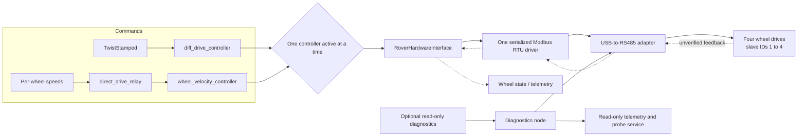

# Rover drivetrain control

ROS 2 Jazzy development package for four BLD-305S wheel drives. All drives share one USB-to-RS485 adapter and Modbus RTU connection; slave IDs 1–4 must be unique. This package is **not validated for motion**: the hardware lifecycle gate remains closed until controller initialization, feedback, stop behavior, and timing are verified.

## How it works



Normal drive commands pass through `ros2_control`; the diagnostics node only reads registers. A Modbus acknowledgement confirms a reply, not that a motor moved. Wheel-side mirroring is configured separately from the shared bus.

## Build and test

From the repository root in a ROS 2 Jazzy environment:

```bash
sudo apt install libmodbus-dev pkg-config
source /opt/ros/jazzy/setup.bash
colcon build --packages-up-to rover_drivetrain_control --symlink-install
source install/setup.bash
colcon test --packages-select rover_drivetrain_control
colcon test-result --verbose
ros2 run rover_drivetrain_control check_drivetrain_plugin
```

## Read-only diagnostics

The launch defaults to probing disabled and does not open a serial port:

```bash
ros2 launch rover_drivetrain_control diagnostics.launch.py
ros2 topic echo /drivetrain_diagnostics/telemetry
```

For an explicitly enabled workshop probe, provide the confirmed adapter settings. Example framing and baud below are placeholders; all four drives must share them. Only one process may own the adapter at a time.

```bash
ros2 launch rover_drivetrain_control diagnostics.launch.py \
  enable_readonly_probe:=true serial_device:=/dev/ttyUSB0 \
  baud_rate:=9600 parity:=N data_bits:=8 stop_bits:=1 response_timeout_ms:=30
```

Every drive ships as address 1. Until the IDs are set to 1–4, connect and probe one drive at a time, because several drives at the same address will answer together and corrupt the reply.

Last year’s rover used shared addresses (1 = right side, 2 = left side), so drives may be saved at address 1 or 2. Probe both, with one drive connected at a time.

Probe a drive by slave ID; `bus` must be `drivetrain`:

```bash
ros2 service call /drivetrain_diagnostics/read_motor_diagnostic \
  rover_drivetrain_interfaces/srv/ReadMotorDiagnostic \
  "{bus: drivetrain, address: 1, register_selector: 1}"
```

Every selector is a function code 03 read. The service returns the raw register value, never converted to physical units. Any other selector is rejected before anything is sent on the bus.

| Selector | Register | Meaning | Status |
|---|---|---|---|
| 1 | `0x0096` | Driver internal temperature | Manual-cited, bench check pending |
| 2 | `0x00B6` | Actual motor current | Manual-cited, bench check pending |
| 3 | `0x00C6` | Actual motor voltage | Manual-cited, bench check pending |
| 4 | `0x00A6` | Drive address | Manual-cited, bench check pending |
| 5 | `0x00F6` | Baud code (`01` = 9600, `04` = 38400) | Manual-cited, bench check pending |
| 6 | `0x0076` | Fault code | Manual-cited, bench check pending |
| 7 | `0x0066` | Running status (`0` stop, `1` forward, `2` reverse, `3` brake) | Manual-cited, bench check pending |
| 8 | `0x005F` | Actual speed (raw) | Manual-cited, bench check pending |
| 9 | `0x0116` | Motor pole pairs (manual default 5) | Manual-cited, bench check pending |
| 10 | `0x0136` | Control mode (`1` = internal, `0` = external) | 0x0136 does not answer reads on our controllers (times out, bench 2026-11-12); write-only, confirmed by write echo. This selector times out |

The response `detail` can name the manual meaning of a value, such as a fault name, but `raw_value` is always the raw register. Selectors 6 and 8 also fill `raw_fault` and `measured_raw_speed` in the diagnostics telemetry. See [`docs/BLD305S_REGISTERS.md`](docs/BLD305S_REGISTERS.md) for every register the package touches, with manual page references. Running code must never write the baud register `0x00F6` or the save register `0x80FF`.

## ros2_control configuration

Copy [`config/drivetrain_hardware.example.yaml`](config/drivetrain_hardware.example.yaml), confirm every value, and pass the copy to the drivetrain launch:

```bash
ros2 launch rover_drivetrain_control drivetrain.launch.py \
  hardware_config:=/path/to/drivetrain_hardware.yaml
```

The config has one `serial_device` and `baud_rate`, shared serial framing, required timing values, and one unique slave ID per wheel. The example adapter path, timings, gearing, and RPM limits are placeholders. The launch runs in `/drivetrain`; twist drive and per-wheel drive share the same wheel interfaces, so only one controller can be active at a time. Per-wheel commands use `[front_left, rear_left, front_right, rear_right]` in rad/s.

The hardware interface currently refuses configuration and activation for motion, unless the opt-in bench mode below is switched on. Do not remove that gate based on a successful build or a read-only Modbus reply. Before motion can be enabled, verify register meanings and scaling against the manufacturer manual and bench readings, confirm fault and stop behavior, add an independent hardware watchdog, and measure the full four-drive bus cycle and four stop acknowledgements. The example timing budgets are unmeasured; remeasure them on this single shared bus.

Wheel geometry in `config/drivetrain_controllers.yaml` and `urdf/drivetrain.urdf.xacro` is also placeholder data. Diagnostics telemetry and interfaces are read-only and intended for logging; production publisher details still need agreement with the GUI team.

## Bench motion test

> **Bench mode moves motors.** It is off by default (`bench_motion_enabled: false`). It needs Forrest's approval and a power cutoff in place before use.

Every run:

- **Wheels off the ground.** Never run bench mode with the rover on the ground.
- **One wheel at a time.** All four controllers stay powered and on the bus at IDs 1–4 (configure needs all four to answer). Spin one wheel at a time in per-wheel mode, with the other three at 0.
- **Low cap.** Start `bench_rpm_cap` well below the 500 RPM ceiling, for example 100.
- **Someone holds a power cutoff on the motor controllers' supply** for the whole run. That cutoff is the hardware stop.
- **Never unattended.**
- **USB adapter latency timer at 1 ms** (see below).

### FTDI latency-timer check

The bench timing assumes about 2 ms of USB adapter latency per exchange. FTDI-based USB-to-RS485 adapters default to a 16 ms latency timer on Linux, which can make every exchange up to about 14 ms slower: the four-drive cycle could then take about 360 ms instead of 244 ms and would no longer fit 2 Hz. Before every run, with the adapter plugged in (replace `ttyUSB0` with your device):

```bash
cat /sys/bus/usb-serial/devices/ttyUSB0/latency_timer          # must print 1
echo 1 | sudo tee /sys/bus/usb-serial/devices/ttyUSB0/latency_timer
cat /sys/bus/usb-serial/devices/ttyUSB0/latency_timer          # confirm 1
```

The setting resets when the adapter is unplugged or the machine reboots, so check it every time. If the `latency_timer` file does not exist, the adapter is not FTDI (for example CH340 or CP210x): it has no such timer, so measure the bus cycle on the bench before trusting the timing below.

**EN is not a safety stop here.** EN is unwired on the rover, and the drives run in internal (Modbus) mode. The manual's EN start/stop behaviour, §7.2 p.5 (PDF p.6), describes terminal control, which we take to apply to external mode only; the manual does not say what EN does in internal mode. Every software stop is a Modbus command, so it fails if the bus fails. The power cutoff covers that case.

### Enabling it

Copy `config/drivetrain_hardware.example.yaml` and set `bench_motion_enabled: true`, `pole_pairs` from the motor datasheet and the probe (selector 9), a low `bench_rpm_cap`, and the bench timing values listed at the end of that file. Production mode is unchanged: with bench mode off, configure and activate still refuse, and the plugin still requires 38400 baud and 15 Hz.

### What bench mode does

- **Configure** opens the bus and, for each wheel, reads the drive address `0x00A6` (must equal the configured ID) and the fault code `0x0076` (must be 0). A failed, mismatched or garbled reply refuses, and the log names the wheel and the reason. Nothing is written. Several drives sharing one address show up as a garbled reply, or, with exactly four drives, as an ID that does not answer.
- **Activate** first broadcasts stop and requires every drive to accept it (status `0`), before any per-drive write. It then polls actual speed `0x005F` until every drive reads at or below 5 motor RPM, and refuses if that has not happened within `bench_stop_deadline_ms` (a failed read counts as not stopped). A motor still coasting from before a deactivation therefore cannot be restarted, even though activation forgets its last direction. Then, for each drive, it writes `0x0136=1` (internal mode) and `0x0116=pole_pairs`, and reads `0x0116` back; writes speed `0x0056=0`; writes stop (`0x0066=0`) and requires running status `0`. A successful write means libmodbus checked the drive's echo of the address and value. The manual documents no read-back for `0x0056`, so the echo is its only confirmation. `0x0136` does not answer reads on our controllers (times out, bench 2026-11-12); write-only, confirmed by write echo. It is never read back. The `0x0116` read-back stays strict: any failure or mismatch refuses. None of these is saved, so power-cycling a drive restores its stored values. If any drive fails, activation refuses and all four are stopped.
- **write()** converts each wheel command: motor RPM = |ω| × 60/(2π) × `gear_ratio`, clamped to the lower of `bench_rpm_cap` and `motor_rpm_limit`. Direction comes from the sign, with `mirrored` applied. Anything below 1 motor RPM is a stop: raw `0x0056` is whole RPM, so this is slightly wider than rounding alone. At most one write per drive per cycle:
  - a stop always goes first;
  - from stop, speed (`0x0056`) is written first, unless a nonzero speed within the cap is already acknowledged; then direction (`0x0066`) goes next, even if the target RPM has changed since, so a command that changes every cycle cannot stop the drive from starting;
  - a reversal goes through stop, then holds: the opposite direction is written only once actual speed `0x005F`, read after the stop, is at or below 5 motor RPM. If no `0x005F` read has succeeded since the stop, it waits 3 cycles instead (a second failed speed poll stops all four first);
  - only changes are written, and each register is re-sent at least once a second.
- **read()** alternates actual speed `0x005F` (converted back to wheel rad/s) and fault code `0x0076`. The drive reports speed as a magnitude, so its sign comes from the last direction written. The exported velocity is **never NaN** while active: it is 0 straight after activation (which has just had the stop accepted by all four), then the last good reading. A single failed speed read keeps the last good value; a second failure in a row stops all four. This matters because `diff_drive_controller` (4.42.1, closed loop) returns an error on NaN wheel feedback before it writes any wheel command, which would also skip its `cmd_vel_timeout` zero and leave the last command running. While inactive, `read()` returns OK without touching the bus.
- **Stops.** Any of these stops all four drives: a fault code other than 0; a fault code that cannot be confirmed (2 failed fault polls in a row, or no good fault read for 2.5 poll intervals, which is 2.5 s at 2 Hz, tracked per drive apart from the cycle health, and reset on activation); speed feedback lost (the same rule for actual-speed reads `0x005F`); a drive lost (existing per-cycle health: invalid after 2 missed cycles, lost after 3); a stop write to one drive that is skipped this cycle (an earlier exchange with it failed) or fails; a failed direction write (the drive's state is then unknown); a late trigger; deactivate, error or shutdown. A failed speed write is simply re-sent. A stop broadcasts `0x0066=0` to address 0, then reads every drive's status. If any status is not 0, it repeats the broadcast until `bench_stop_deadline_ms` (at most 5000 ms) runs out. Because a stop that cannot reach one drive becomes a broadcast, a safety stop never stops one side only. After a fault, unconfirmed-fault, lost-speed-feedback, loss, failed-write or late-trigger stop, motion stays latched off until the next successful activation.
- **"Stop accepted" is not "stopped".** Status `0` means the drive accepted the stop command, not that the motor has run down; the logs say "stop accepted (status 0)" and add each drive's raw `0x005F` read just after, so a motor still turning shows up there. Run the bench test step below to see how long the motor takes to reach zero.
- **If a stop is not accepted:** `on_deactivate` returns FAILURE and the hardware stays active, with motion latched off; nothing more is sent from `read()` or `write()`. `on_error` keeps the bus open and keeps broadcasting stop at the update rate for 10 s, logging "use the power cutoff" on every attempt, then returns FAILURE. A repeated `on_error` does the same again and returns FAILURE until all four accept the stop. In every case, use the power cutoff.
- **Never** writes `0x00F6` (baud), `0x00A6` (address) or `0x80FF` (save). The driver also refuses those addresses.

### Bench test step: what a stop really does

Do this on the day, before anything else. It shows how long a motor takes to reach zero after a stop, and whether status `0` means "stopped" or only "accepted".

**Setup.** All four controllers are powered and on the bus at IDs 1–4: configure needs all four to answer, so you cannot test with one drive alone. All four wheels are off the ground, and someone holds the power cutoff. Test **one wheel at a time**, with the other three commanded to 0.

1. Activate bench mode, then switch to per-wheel mode. `wheel_velocity_controller` starts inactive, and only one drive controller can be active at a time:

   ```bash
   ros2 control switch_controllers -c /drivetrain/controller_manager \
     --deactivate diff_drive_controller --activate wheel_velocity_controller
   ```

2. Spin one wheel slowly through the direct-drive relay. The order is `[front_left, rear_left, front_right, rear_right]` in rad/s. The relay needs at least 10 messages a second, or it sends zeros. To test front-left:

   ```bash
   ros2 topic pub -r 20 /drivetrain/direct/wheel_speeds std_msgs/msg/Float64MultiArray \
     "{data: [0.2, 0.0, 0.0, 0.0]}"
   ```

3. In a second terminal, log actual speed (`0x005F`, converted to rad/s and refreshed once a second at 2 Hz) with timestamps, and keep the plugin's log visible:

   ```bash
   ros2 topic echo /drivetrain/joint_states | ts '%H:%M:%.S' | tee speed_log.txt
   ```

4. Command zero and note the time, **keeping the hardware active**. Stop the publisher in step 2 and publish zeros instead (in diff-drive mode, release the stick):

   ```bash
   ros2 topic pub -r 20 /drivetrain/direct/wheel_speeds std_msgs/msg/Float64MultiArray \
     "{data: [0.0, 0.0, 0.0, 0.0]}"
   ```

   The plugin writes `0x0066=0` to that drive; a commanded zero produces no log line. **Do not deactivate yet:** while active, the plugin keeps reading `0x005F`, so step 3 shows the run-down. After deactivation it stops reading, and `joint_states` would freeze at its last value.
5. Watch step 3 until that wheel's velocity reads 0. The time from step 4 to that point is the run-down.
6. Only then deactivate the hardware. Look for the WARN log line containing `stop accepted (status 0)`: every drive reported `0x0066 = 0`, and the line ends with `0x005F raw motor RPM just after:` and each drive's raw speed (`n/a` if that read failed; the result is unchanged). After a full run-down these should be 0. **A nonzero value there means status 0 was only "accepted": that motor was still turning.**
7. Repeat steps 2–6 for each of the other three wheels.

Activation also refuses until every drive's `0x005F` reads at or below 5 motor RPM. If you reactivate too soon after a run, wait and try again.

`ts` comes from the `moreutils` package.

### Bench rate: timing at 9600 baud

Four drives on one bus at 9600 baud, 8N1: 10 bits per character is 1.042 ms, and the 3.5-character frame gap is 3.65 ms. The manual gives no drive turnaround time, so 5 ms is a placeholder. The estimates also assume about 2 ms of USB adapter latency per exchange, which needs the FTDI latency timer at 1 ms (see the check above).

| Exchange | Characters | Wire time | + gaps | Floor | Estimate |
|---|---|---|---|---|---|
| FC03 read, 1 register | 8 + 7 = 15 | 15.6 ms | 2 × 3.65 ms | 22.9 ms | ~30 ms |
| FC06 write | 8 + 8 = 16 | 16.7 ms | 2 × 3.65 ms | 24.0 ms | ~31 ms |
| Broadcast stop | 8 | 8.3 ms | 1 × 3.65 ms | 12.0 ms + 50 ms reply timeout | ~62 ms |

libmodbus 3.1.10 waits `response_timeout_ms` for a reply to a broadcast that never comes, which is why the broadcast row includes the timeout.

The existing timing rule keeps the worst bus cycle at or below 50% of the period:

- **Both reads plus direction and speed writes every cycle:** 4 × (2 × 30 + 2 × 31) = 488 ms, which needs a period of at least 976 ms: 1 Hz.
- **One alternating read plus at most one write per drive:** 4 × (30 + 31) = 244 ms, which is 49% of 500 ms: **2 Hz**. The wire-only floor is 187.5 ms.
- **3 Hz:** 50% of 333 ms is 167 ms, below the 187.5 ms floor, so it is impossible.

Bench mode therefore runs at **2 Hz** (`update_hz: 2`) with alternating reads and one write per drive per cycle. The rest follows from that:

- **Stop attempt:** broadcast 62 ms + 4 status reads × 30 ms = 182 ms, against a floor of 153.6 ms, so `measured_stop_wire_budget_ms: 200` until measured.
- **Stop deadline:** upstream timeout 110 ms + 2 periods (1000 ms) + stop budget 200 ms = 1310 ms, so `bench_stop_deadline_ms: 1500`.
- **Late trigger:** between one and two periods, and 110 + late + 200 ≤ 1500, so `late_trigger_ms: 750`.
- **At 2 Hz:** each drive's fault code is read once a second; a silent drive is lost after 1.5 s; a start from stop takes 2 cycles (speed, then direction) and a reversal 3; the worst-case software stop is about 1.3 s. That is why the person on the power cutoff is the real stop.

The plugin refuses `measured_worst_bus_cycle_ms` or `measured_stop_wire_budget_ms` below the wire-only floors for the configured baud and framing. All of these numbers are placeholders until the bus is measured on the bench.

See [`docs/VERIFICATION_MATRIX.md`](docs/VERIFICATION_MATRIX.md) for verification results and remaining checks.
